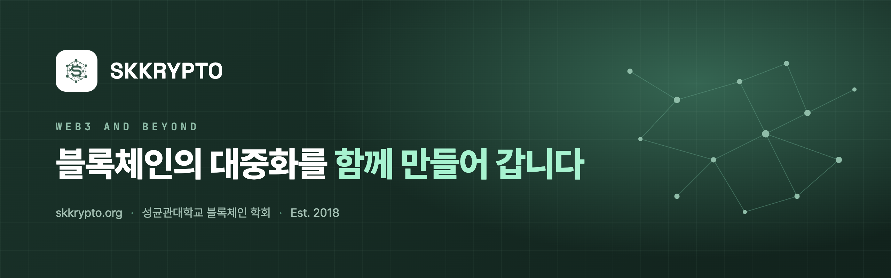

# SKKRYPTO

**성균관대학교 블록체인 학회** · Sungkyunkwan University Blockchain Network · Est. 2018

스크립토는 다양한 학과의 학생들이 융합적 관점으로 블록체인을 연구하고 직접 개발하며, 진입장벽을 낮춰가는 성균관대학교 블록체인 학회입니다.
리서치팀은 블록체인 기획·리서치와 Case Study를, 개발팀은 스마트컨트랙트와 dApp 개발을 맡습니다.

[홈페이지](https://skkrypto.org) · [지원하기](https://skkrypto.org/ko/apply/) · [Medium](https://medium.com/skkrypto) · [Brunch](https://brunch.co.kr/@skkrypto) · [Instagram](https://www.instagram.com/skkrypto/) · [X](https://x.com/skkrypto)

## 진행 중인 프로젝트

| 프로젝트 | 설명 |
|---|---|
| [skkrypto-tracker](https://github.com/SKKU-SKKRYPTO/skkrypto-tracker) | 지정한 데이터 범위에서 주소 간 토큰 이동 경로와 분석 근거를 제시하는 온체인 추적 도구 |

## 지난 프로젝트

| 연도 | 프로젝트 | 설명 |
|---|---|---|
| 2024 | [2024_Uniswap_v1](https://github.com/SKKU-SKKRYPTO/2024_Uniswap_v1) | AMM의 동작 원리를 바닥부터 구현한 Uniswap v1 스터디 |
| 2024 | [Skkrypto_12th_Team_Project](https://github.com/SKKU-SKKRYPTO/Skkrypto_12th_Team_Project) | 12기 학회원들이 설계·개발한 스마트컨트랙트 프로젝트 |
| 2022 | [2022_DAO](https://github.com/SKKU-SKKRYPTO/2022_DAO) | 탈중앙 거버넌스를 실험한 DAO SDK 프로젝트 |
| 2022 | [2022_EVERIPLANET](https://github.com/SKKU-SKKRYPTO/2022_EVERIPLANET) | Web3 dApp 프로젝트 |
| 2021 | [Skkrypto_7th_Team_A_Project](https://github.com/SKKU-SKKRYPTO/Skkrypto_7th_Team_A_Project) | 블록체인을 이용한 투명한 이벤트 추첨 웹페이지 |

그 밖의 스터디와 초기 프로젝트는 [전체 저장소 목록](https://github.com/orgs/SKKU-SKKRYPTO/repositories)에서 볼 수 있습니다.

## 문의

skkrypto.io@gmail.com
